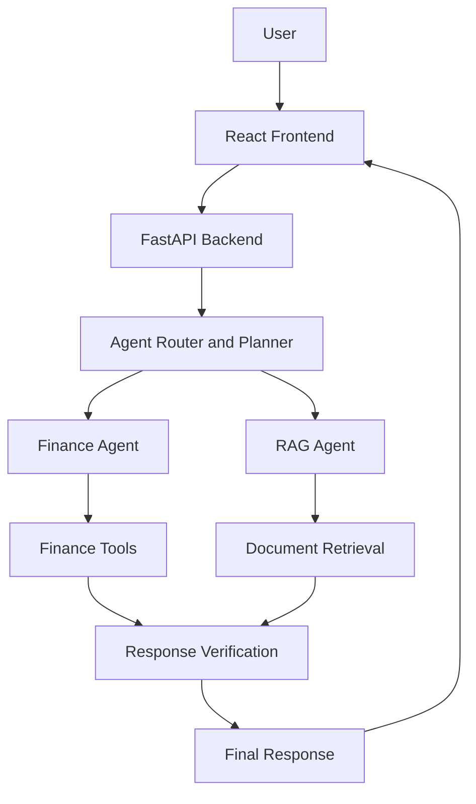

# FinVoice AI — Intelligent Finance Assistant

**An AI-powered finance assistant designed to help users understand financial information through intelligent agents, retrieval-augmented generation (RAG), and verified responses.**

FinVoice AI is a full-stack AI project combining a Python backend with a React frontend. Its goal is to make financial information easier to explore through natural-language interactions, finance tools, and document-grounded answers.

> **Project status:** Under active development.

## Key Features

- **AI Finance Assistant:** Designed to answer finance-related questions.
- **Agent-Based Architecture:** Organizes tasks using planning, routing, and specialized agent components.
- **Retrieval-Augmented Generation (RAG):** Retrieves relevant document information to support grounded responses.
- **Financial Tools:** Provides backend services for finance-related operations.
- **Response Verification:** Includes verification components intended to improve answer reliability.
- **Full-Stack Application:** React frontend connected to a FastAPI backend.
- **Extensible Architecture:** Structured to support additional agents and capabilities.

*Feature availability depends on the current implementation and configuration.*

## Architecture



## Tech Stack

| Component            | Technology                              |
| -------------------- | --------------------------------------- |
| Backend              | Python, FastAPI                         |
| Frontend             | React, JavaScript                       |
| Frontend tooling     | Vite, npm                               |
| AI orchestration     | Agent routing and planning              |
| Knowledge retrieval  | RAG, embeddings, vector storage         |
| Database integration | SQLAlchemy and PostgreSQL configuration |
| Version control      | Git and GitHub                          |

## Project Structure

```text
finvoice_AI/
├── backend/
│   ├── main.py
│   ├── config.py
│   ├── database.py
│   ├── rag/
│   │   ├── document_loader.py
│   │   ├── embeddings.py
│   │   ├── retriever.py
│   │   ├── rag_agent.py
│   │   └── vector_store.py
│   └── services/
│       ├── planner.py
│       ├── finance_agent.py
│       ├── finance_tools.py
│       ├── verifier.py
│       └── synthesizer.py
├── frontend/
│   ├── src/
│   │   ├── components/
│   │   ├── pages/
│   │   └── services/
│   └── package.json
├── agent_router.py
├── requirements.txt
├── test_api.py
├── test_difference_verification.py
├── .gitignore
└── README.md
```

## Getting Started

### Prerequisites

Install the following before running the project:

- Python compatible with the dependencies in `requirements.txt`
- Node.js and npm
- Git
- PostgreSQL, if required by your local configuration
- Any AI provider credentials required by the configured services

### 1. Clone the repository

```bash
git clone https://github.com/punithyadavbn3167-art/finvoice_AI.git
cd finvoice_AI
```

### 2. Set up the Python backend

Create and activate a virtual environment on Windows:

```powershell
python -m venv .venv
.\.venv\Scripts\Activate.ps1
```

Install the backend dependencies:

```powershell
python -m pip install -r requirements.txt
```

### 3. Configure environment variables

Create a local `.env` file if required by the application configuration.

Add the environment variables needed by your configured database and AI services. Check `backend/config.py` and the relevant service files for the exact variable names.

**Never commit `.env` or expose API keys, database passwords, or other credentials.**

### 4. Start the backend

From the project root, run:

```powershell
uvicorn backend.main:app --reload
```

When the server starts successfully, open:

- API documentation: [http://127.0.0.1:8000/docs](http://127.0.0.1:8000/docs)
- OpenAPI schema: [http://127.0.0.1:8000/openapi.json](http://127.0.0.1:8000/openapi.json)

### 5. Start the frontend

Open a second terminal:

```powershell
cd frontend
npm install
npm run dev
```

Open the local URL printed by Vite in your terminal.

Ensure the frontend API configuration points to the correct backend URL.

## Testing

Run the available Python tests from the project root:

```powershell
python -m pytest
```

Some tests may require additional environment variables, a running database, AI provider access, or a configured vector store.

## Roadmap

- [ ] Establish the FastAPI backend and React frontend
- [ ] Build initial agent routing and planning components
- [x] Implement initial finance and RAG components
- [x] Add response verification components
- [x] Improve automated testing and error handling
- [x] Strengthen financial calculation validation
- [ ] Improve document ingestion and retrieval evaluation
- [ ] Develop voice-based interaction
- [ ] Improve deployment, security, and documentation

## Security and Responsible Use

- Keep credentials in environment variables rather than source code.
- Never upload private financial documents or personal financial records.
- Validate financial calculations and data sources before relying on results.
- Treat AI-generated responses as informational, not as a substitute for professional financial advice.

## Contributing

Contributions, suggestions, and bug reports are welcome. For significant changes, open an issue or discuss the proposed improvement before submitting a pull request.

## Author

**Punith Yadav B N**

GitHub: [@punithyadavbn3167-art](https://github.com/punithyadavbn3167-art)

## License

No license has been specified yet. Add a license file if you intend to define how others may use, modify, and distribute this project.
